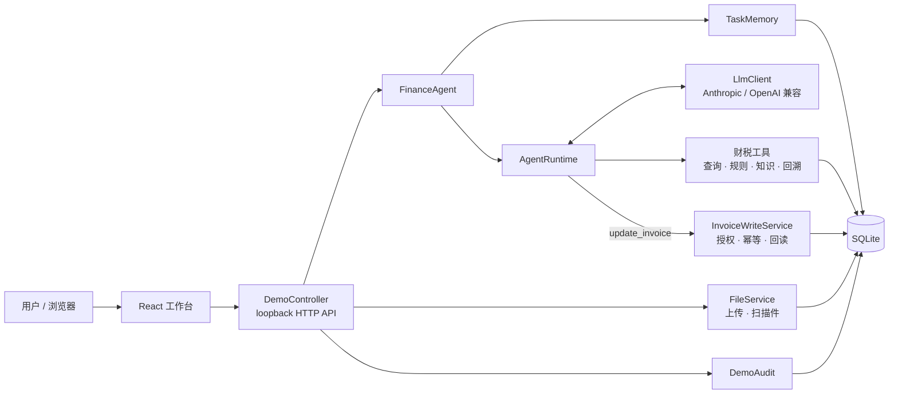

<div align="center">

# Tax Agent Harness

**面向财税业务的可靠、可审计 Agent 执行框架**

[](https://github.com/SuperGh2233/tax-agent-harness/actions/workflows/fresh-checkout.yml)


[快速开始](#快速开始) · [系统架构](#系统架构) · [模型配置](#模型配置) · [测试与验证](#测试与验证) · [文档](#文档)

</div>

Tax Agent Harness 把大模型的任务理解与工具选择，和确定性的业务规则、权限控制、任务记忆、数据库写入核验结合在一起。Agent 不只是“给出答案”：它在受约束的流程里推进财税任务，并为每次关键操作留下可核验的执行证据。

> [!IMPORTANT]
> 这是比赛/研究型本地演示项目，不是生产财务系统：只监听 `127.0.0.1`，没有生产级身份认证，只使用官方合成数据或自行构造的合成文件。

## 项目特点

- **模型决策，程序把关**：模型按上下文选择工具，不靠关键词路由；金额（整数分）、规则判断、权限、保存与回读都由程序完成。
- **受控写入**：发票只允许修改 `purpose` 与 `remarks`。每次写入都要本轮逐项确认的一次性授权，经 `operationId` 幂等台账执行，再回读数据库，`verified=true` 才算成功。
- **诚实失败**：规则矛盾或无法解析时返回 `UNSUPPORTED_SCOPE`，未配置模型时返回 `MODEL_NOT_CONFIGURED`；结果未知时阻止自动重试，不把未知当成功。
- **可审计**：只追加的脱敏审计和每轮 `agent_trace`，能看到模型输入、记忆、规则、工具调用与结果。
- **单一 React 工作台**：`mvn package` 自动构建前端并打进 JAR。

### 复赛八项核心能力

| 能力 | 实现要点 |
| --- | --- |
| Agent 管理 | 可配置 Agent（提示词、模型配置、能力、适用企业）；版本不可改，修改从下一轮生效 |
| 能力组织与复用 | 工具与技能的注册、版本和全局启停；技能不能授予写入权限 |
| 多轮办理 | 任务状态跨轮持久化；用户补充的字段在保存核验前，任务不会结项 |
| 长期记忆 | 本人·本企业、本人·所有企业、企业共享三个范围；删除即擦除 |
| 知识库策略 | `search_knowledge` 只在当日启用的规则和已启用的上传文件中检索，并给出出处 |
| 文件处理 | 上传 xlsx / xls / docx / 文本 PDF 导入（只补缺失键）；陌生表头由会计做列对应；扫描件识别后逐项确认 |
| 上下文管理 | 每轮上下文 ≤6000 字符，大结果压缩成摘要，需要时用 `recall_context` 分页取回原文 |
| 异常恢复 | 只读工具有限重试，写入永不自动重试，连续错误熔断，结果未知只走只读核验 |

另有复赛视频提到的扩展：回复语气、批量保存与复核（2–20 张，单事务全成或全不改）、扫描件票面金额确认、审计 CSV 导出。

## 系统架构



| 包 | 主要类 | 职责 |
| --- | --- | --- |
| `harness/`（根包） | `HarnessApplication`、`DataInitializer` | 启动入口、种子初始化、健康检查 |
| `demo/` | `DemoController`、`DemoSecurity`、`DemoAudit` | 本地 HTTP API、会话与 CSRF、脱敏审计、规则 CLI |
| `runtime/` | `FinanceAgent`、`AgentRuntime`、`TaskMemory`、`AgentDirectory`、`CapabilityRegistry` | 决策循环、任务与长期记忆、Agent 与能力配置、模型适配 |
| `tool/` | `ReadOnlyFinanceTools`、`RuleService`、`KnowledgeService`、`FileService`、`InvoiceWriteService`、`PermissionGuard` | 查询、规则、检索、文件导入、受控写入、权限校验、SQLite |

### 一次受控保存

1. 用户创建财税任务并描述目标。
2. Agent 读取当前企业范围内的发票、流水和规则。
3. 信息不足时 Agent 追问；用户可以补充或更正明确事实。
4. 需要修改发票时，用户在审核页逐项核对企业、发票、字段和精确值，并二次确认。
5. 模型在本轮授权范围内调用写入工具；业务层再次校验权限、规则、字段和操作编号。
6. 系统回读数据库核验结果，并在任务与审计中记录执行状态。

> [!NOTE]
> 模型说的“已保存”、任务的完成状态都不算业务成功。保存是否成功只看本轮工具结果和数据库回读。

## 快速开始

### 环境要求

| 依赖 | 版本 | 说明 |
| --- | --- | --- |
| JDK | 21 | 必需 |
| Maven | 3.6.3+ | 也可用仓库自带的 `./mvnw`（Windows 用 `mvnw.cmd`，固定 3.9.9） |
| Node.js / npm | 22.12+ | 只在前端开发时需要；`mvn package` 会自行下载 Node |

> [!TIP]
> 全新检出 + 空 Maven 缓存的在线构建与离线复跑，已在 macOS 本机和 GitHub Actions 的 Ubuntu / Windows / macOS 上通过，JDK 21 + Maven 3.6.3 的最低组合也实测过，见 [REPRODUCE.md](REPRODUCE.md)。

### 1. 构建

```bash
mvn test                  # 后端测试，不构建前端
mvn -DskipTests package   # 可执行 JAR，含 React 工作台；首次需联网下载 Node/npm 与依赖
```

<details>
<summary>离线环境怎么构建</summary>

先在联网机器完成一次 `mvn -DskipTests package`，之后可以直接用预构建 JAR；或者在已有 `frontend/dist` 的机器上执行：

```powershell
powershell -ExecutionPolicy Bypass -File scripts/package_offline.ps1
```

它内部运行 `mvn -o -DskipTests -Dfrontend.skip=true package`。

</details>

### 2. 初始化演示数据库

> [!WARNING]
> 每次演示都新建临时库。不要用 `data/harness.db` 或任何已有库，也不要放入真实财务数据。

```bash
DEMO_DIR="$(mktemp -d)"
DEMO_DB="$DEMO_DIR/demo.db"

java -jar target/harness-0.0.1-SNAPSHOT.jar --initialize-data --database="$DEMO_DB"
```

初始化器导入官方合成样例（2 家企业、2 个用户、40 张发票、48 条流水、5 条规则版本）后直接退出。普通启动不会自动初始化或重置数据库。

### 3. 启动服务

```bash
env -u LLM_ENDPOINT -u LLM_API_KEY -u LLM_MODEL \
  java -jar target/harness-0.0.1-SNAPSHOT.jar \
  --taxagent.database="$DEMO_DB" \
  --server.address=127.0.0.1 --server.port=8080
```

这条命令去掉了模型变量，以无模型模式预览界面；接入模型见[模型配置](#模型配置)。

```bash
curl http://127.0.0.1:8080/api/health   # {"status":"UP"}
```

> [!NOTE]
> 初始化用 `--database`，启动服务用 `--taxagent.database`，两者不能混用。Windows 下的命令与排障见 [REPRODUCE.md](REPRODUCE.md)。

### 4. 打开工作台

浏览器访问 <http://127.0.0.1:8080/>，会自动跳转到 `/react-app/`。未配置模型时，任务请求会明确返回 `MODEL_NOT_CONFIGURED`，不会伪造成功结果。

## 前端开发

先按上文启动后端，再开一个终端：

```bash
cd frontend
npm ci
npm run verify   # 类型检查 + ESLint + Vitest + 生产构建
npm run dev      # http://127.0.0.1:5173/react-app/
```

Vite 只监听本机回环地址，并把 `/api` 代理到 `127.0.0.1:8080`；后端换了端口时用 `T15_BACKEND_ORIGIN=http://127.0.0.1:<port> npm run dev`。更多说明见 [frontend/README.md](frontend/README.md)。

## 模型配置

模型只通过环境变量配置，`.env` 不会自动加载。

| 变量 | 说明 |
| --- | --- |
| `LLM_ENDPOINT` | 模型服务地址 |
| `LLM_API_KEY` | 模型服务凭证 |
| `LLM_MODEL` | 型号；开发期用 `qwen3.7-flash`，最终比赛用 `qwen3.8-flash` |
| `LLM_PROTOCOL` | `anthropic` 走 Messages API；不填或填其他值时，endpoint 路径含 `/anthropic` 也走 Messages，否则走 OpenAI 兼容接口 |
| `LLM_VISION_*` | 扫描件读图的独立配置（`_ENDPOINT` / `_API_KEY` / `_MODEL` / `_PROTOCOL`），必须是能读图的模型；未配置时扫描件走手工录入，不借用 `LLM_*` |
| `LLM_<NAME>_*` | 命名模型配置，供 Agent 按名称引用；未配置的名称不会回退到其他配置 |

示例（DashScope Anthropic 兼容入口）：

```bash
export LLM_ENDPOINT=https://dashscope.aliyuncs.com/apps/anthropic
export LLM_API_KEY=<your-key>
export LLM_MODEL=qwen3.8-flash
export LLM_PROTOCOL=anthropic
```

- OpenAI 兼容网关：endpoint 以 `/responses` 结尾时走 Responses API，否则自动补 `/chat/completions`。
- 换模型只改环境变量，工具、规则、证据门和审计都不依赖具体供应商。注意 `qwen3.8` 这个名称接口不认（HTTP 400），要写 `qwen3.8-flash`。
- 缺少任意一项配置时返回 `MODEL_NOT_CONFIGURED`。模型超时 60 秒，不重试；回复格式无法解析时纠正重试一次，仍失败返回 `MODEL_RESPONSE_INVALID`。

> [!CAUTION]
> 密钥只放在本机环境变量里，不要写进源码、日志、截图、文档或 Git。

## 安全与可靠性设计

- **本地身份模拟**：Operator / Viewer 固定映射到比赛样例用户 U001 / U002，身份从不取自请求体或模型参数。这不是生产认证。
- **权限与企业隔离**：服务端从可信会话确定身份，每次业务操作都在事务内重新检查数据库权限。
- **请求来源保护**：只接受直接 loopback、同源、带 CSRF Token 的请求，并限制请求体大小与频率；不提供公网访问或 CORS。
- **写入授权隔离**：普通聊天、任务恢复和信息补充都不会授权写入；写入必须绑定本轮的明确确认，授权用一次即失效。
- **幂等与回读**：用 `operationId` 和操作台账防止重复执行，保存后在同一事务内回读核验；批量保存单事务全成或全不改。
- **未知结果保护**：超时或回读未确认时保留操作编号并阻止自动重试，只能经只读接口核验。
- **审计记录**：每次变更前先写审计，审计不可用则拒绝执行；审计只保存脱敏摘要。

> [!WARNING]
> 服务只面向单机 loopback。任务变更的进程内锁只在单个 JVM 内有效，不提供多实例分布式锁。不要部署到公网，也不要用于真实财务业务。

## 测试与验证

```bash
mvn test                       # 后端全量测试
cd frontend && npm run verify  # 前端类型检查、Lint、Vitest、构建
```

进程级检查脚本都在 `scripts/`，跑在已打好的 JAR 上（合成数据、独立临时库、只走 loopback）：

| 脚本 | 检查内容 | 是否调用模型 |
| --- | --- | --- |
| `fault_injection_check.py --jar <jar>` | 故障注入：超时、429、畸形回复、工具错误熔断、保存后进程被杀、流式中途断开 | 否（本机桩模型） |
| `long_conversation_check.py --jar <jar>` | 30 轮长对话 | 是，消耗额度 |
| `large_result_check.py --jar <jar>` | 大工具结果的分页取回 | 是，消耗额度 |
| `fresh_checkout_check.py [--maven 3.6.3\|wrapper]` | 全新克隆 + 空缓存构建（只覆盖已提交内容，需联网） | 否 |

发布前还要用到 `secret_scan.py`（查密钥）、`dependency_scan.ps1` / `osv_scan.py`（依赖漏洞扫描）、`official_seed.py --check`（核对种子）等脚本，顺序与文件白名单见 [RELEASE_CHECKLIST.md](RELEASE_CHECKLIST.md)。

<details>
<summary>最近一次验证结果</summary>

测试数为 2026-11-22 推送的 `b0c8b62`（含 T49–T51）；全新检出与 CI 为 2026-11-21 的 T45–T48 提交；其余为 2026-11-20 提交 `220b26c` / `64e4a63`。逐项证据见 [TASKS.md](TASKS.md) T38–T51 与 `docs/evidence/`。

| 验证项 | 结果 |
| --- | --- |
| Java 21 Maven 全量测试 | 353 passed，0 failures，0 errors，0 skipped |
| 前端 `npm run verify`（TypeScript、ESLint、Vitest、Vite build） | 通过；Vitest 63 passed |
| 全新检出 + 空 Maven 缓存：在线 test/package、JAR 内含 React 页面、新库初始化、loopback 健康检查、离线复跑 | macOS 本机 Wrapper 3.9.9 与 Maven 3.6.3 均通过（基于 `05bfcab`，351 项）；GitHub Actions run `44916473839` Ubuntu / Windows / macOS（Wrapper 3.9.9）与 Ubuntu（Maven 3.6.3）四作业全绿（基于 `7d20c66`，各 351 项）；T49–T51 之后未重跑 |
| 故障注入（真实 JAR + 本机桩模型） | 8 个场景 40 项通过 |
| 真实模型 `qwen3.7-flash`：受控保存对比、30 轮长对话、大工具结果分页取回 | 程序行为项全部通过（模型行为项单列，见 T37–T39） |
| 真实模型 `qwen3.8-flash`（最终比赛型号）：扫描件识别、2 张批量保存 | 通过（`docs/evidence/T47_T48_QWEN38_20261121/`） |
| 真实 Chrome + 打包 JAR：列对应、扫描件确认、批量保存三个页面 | 通过（`docs/evidence/T45_T48_BROWSER_20261121/`）；T49–T51 的新界面待复核 |

更早的快照（2026-11-02 的 223 项、2026-11-11 的 252 项等）保留在 TASKS.md 与 REPRODUCE.md 的时间线里，不代表当前状态。API 验证与浏览器 UI 验证分开记录。

</details>

## 项目结构

```text
.
├── src/main/java/com/taxagent/harness/   # 根包：启动入口、种子初始化、健康检查
│   ├── demo/                             # HTTP API、会话安全、审计、规则 CLI
│   ├── runtime/                          # Agent 循环、任务与长期记忆、模型适配
│   └── tool/                             # 财税工具、文件导入、受控写入、SQLite
├── src/main/resources/                   # application.yml、迁移 SQL、官方种子、工具契约
├── src/test/java/                        # JUnit 单元与集成测试
├── frontend/                             # React + TypeScript 工作台（src/、tests/）
├── scripts/                              # 进程级检查、安全扫描、发布脚本
├── docs/                                 # 契约、设计、计划与证据（索引 docs/index.md）
├── .github/workflows/                    # 全新检出构建 CI（三平台 + Maven 3.6.3）
├── REPRODUCE.md                          # 独立复现指南
├── RELEASE_CHECKLIST.md                  # 交付检查清单
├── TASKS.md                              # 任务与进度台账
└── pom.xml
```

> [!NOTE]
> 根目录下的两个 `赛题二：…` 目录及同名 `.zip`、项目计划书 `.docx` 是官方比赛原件；`财税AgentHarness-提交包-*.zip`、`演示讲稿.md`、`DEMO_SCRIPT.md` 是提交用材料。它们都不参与构建，也不要编辑官方原件。

## 文档

| 文档 | 内容 |
| --- | --- |
| [作品使用说明](作品使用说明.md) | 浏览器工作台的操作说明 |
| [自主创新说明](自主创新说明.md) | 创新点与前后对比数据 |
| [独立复现指南](REPRODUCE.md) | 环境准备、构建、初始化、启动与排障 |
| [复赛契约](docs/FINAL_ROUND_CONTRACT.md) | 复赛范围与约束（优先于初赛契约） |
| [初赛契约](docs/BUSINESS_CONTRACT.md) | 初赛冻结边界与回归基线 |
| [文档索引](docs/index.md) | 详细设计与技术契约 |
| [任务台账](TASKS.md) | 开发进度、验收证据与遗留事项 |
| [交付检查清单](RELEASE_CHECKLIST.md) | 比赛交付材料、白名单与检查项 |
| [开发交接说明](docs/agent-handoff.md) | 当前代码状态、验证证据与接手顺序 |
| [复赛演示讲稿](演示讲稿.md) / [初赛演示脚本](DEMO_SCRIPT.md) | 录屏流程与口播 |
| [前端说明](frontend/README.md) | React 工作台开发与构建 |
| [项目计划书](财税_Agent_Harness_项目计划书_V1.1_共享任务池.docx) · [官方初赛材料](赛题二：财税Harness初赛材料包-v1.1.0/) | 比赛背景、官方规则与合成样例数据 |

## 当前状态

> [!NOTE]
> 复赛作品已提交（提交包 `财税AgentHarness-提交包-20261123.zip`）。

- **已完成**：复赛范围（`docs/FINAL_ROUND_CONTRACT.md`）的 T28–T43；四项可选扩展 T45–T48，有全新检出、CI、`qwen3.8-flash` 真实模型与浏览器证据；T49–T51（界面改版与动效、业务化工具名、可操作的空审核页、审计 CSV 导出、规则正文导入检查）已推送（`b0c8b62`）并通过自动化测试。
- **未补做的验证**：T49–T51 新界面的浏览器复核，以及之后的全新检出 / CI 重跑。
- 本系统用于比赛演示与技术验证，不具备生产环境所需的认证、部署、防篡改审计和运维能力。

接手开发请先读 [开发交接说明](docs/agent-handoff.md)，再看 [TASKS.md](TASKS.md)。

---

<div align="center">
<sub>Built with Java, React and a focus on reliable Agent execution.</sub>
</div>
