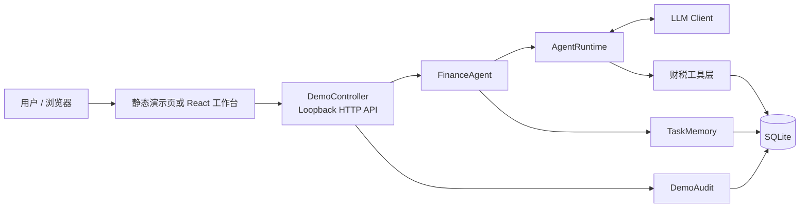

# Tax Agent Harness

<p align="center">
  <strong>面向财税业务的可靠、可审计 Agent 执行框架</strong>
</p>

<p align="center">
  
  
  
  
  
</p>

Tax Agent Harness 是一个面向财税业务场景的 Agent 应用项目。它将大模型的任务理解与工具选择能力，和确定性的业务规则、权限控制、任务记忆及数据库写入验证结合起来，让 Agent 不只是“给出答案”，还能够在受约束的流程中推进任务，并为关键操作保留可核验的执行证据。

> **项目定位：** 比赛/研究型本地演示项目，不是生产财务系统，也不提供生产级身份认证。

## 目录

- [项目特点](#项目特点)
- [系统架构](#系统架构)
- [核心流程](#核心流程)
- [技术栈](#技术栈)
- [快速开始](#快速开始)
- [React 工作台](#react-工作台)
- [模型配置](#模型配置)
- [安全与可靠性设计](#安全与可靠性设计)
- [测试与验证](#测试与验证)
- [项目结构](#项目结构)
- [文档](#文档)
- [当前状态与限制](#当前状态与限制)

## 项目特点

- **模型驱动的工具调用：** 由模型根据上下文选择工具，不依赖关键词路由；工具参数经过 Schema 和业务层校验。
- **财税只读查询：** 分别查询发票与银行流水，按企业、月份和权限范围读取数据。
- **规则版本管理：** 查询适用规则、检查发票用途缺口；不支持或存在歧义的规则不会被静默猜测。
- **跨轮任务记忆：** 任务状态、待补充信息和用户明确提供的内容持久化到 SQLite，支持恢复、补充和取消。
- **受控财务写入：** 写入仅允许白名单字段，并要求本轮明确授权；保存后通过操作台账和数据库回读核验。
- **可审计执行：** 记录任务与工具操作的脱敏审计摘要，便于追踪操作结果。
- **双前端入口：** 保留原生静态演示页面，并提供独立的 React + TypeScript 工作台。

## 系统架构



**主要模块：**

| 模块 | 职责 |
| --- | --- |
| `AgentRuntime` | 管理模型决策、工具调用、执行步数和错误处理 |
| `FinanceAgent` | 组合任务记忆、Agent Runtime 与财务写入能力 |
| `ReadOnlyFinanceTools` | 查询发票与银行流水 |
| `RuleService` | 查询规则版本、检查发票用途 |
| `InvoiceWriteService` | 校验一次性授权、执行白名单写入、幂等处理与回读 |
| `TaskMemory` | 保存任务状态、用户补充和跨轮上下文 |
| `DemoController` / `DemoAudit` | 提供本地演示 API、会话边界和脱敏审计 |

## 核心流程

1. 用户创建财税任务并描述目标。
2. Agent 读取当前企业范围内的发票、流水和规则信息。
3. 信息不足时，Agent 追问；用户可以补充或更正明确事实。
4. 需要修改发票时，用户逐项核对企业、发票、字段和精确值，并进行二次确认。
5. 模型在本轮授权范围内选择写入工具；业务层再次校验权限、规则、字段和操作编号。
6. 系统读取数据库回查写入结果，并在任务与审计中保留执行状态。

模型输出的自然语言、任务完成状态或“已保存”等文字都不等于业务成功。写入是否成功以实际工具结果和数据库回读为准。

## 技术栈

| 层次 | 技术 |
| --- | --- |
| 后端 | Java 21、Spring Boot 3.5.16、Maven |
| Agent | 自定义 Agent Runtime、Tool Calling、任务状态管理 |
| 数据存储 | SQLite、JDBC |
| 模型接入 | DashScope Anthropic-compatible Messages、OpenAI-compatible Responses / Chat Completions |
| 前端 | React 19、TypeScript、Vite 7、Tailwind CSS 4、Radix UI |
| 测试 | JUnit 5、Vitest、TypeScript、ESLint |

## 快速开始

### 环境要求

- JDK 21
- Maven 3.6.3+
- Node.js 22.12+（仅运行 React 前端时需要）
- npm

首次构建需要下载 Maven 依赖；前端首次安装需要访问 npm registry。项目已在 macOS 环境进行验证，其他操作系统尚未完成完整复现验证。

### 1. 获取代码并运行后端

在仓库根目录执行：

```bash
java -version
mvn -version

# 运行后端测试
mvn test

# 构建可执行 JAR
mvn -DskipTests package
```

### 2. 初始化独立演示数据库

**建议每次演示使用新建的临时数据库。不要将真实财务数据或已有的 `data/harness.db` 用作演示库。**

macOS / Linux：

```bash
DEMO_DIR="$(mktemp -d)"
DEMO_DB="$DEMO_DIR/demo.db"

java -jar target/harness-0.0.1-SNAPSHOT.jar \
  --initialize-data \
  --database="$DEMO_DB"
```

初始化器导入官方比赛提供的合成样例数据。普通应用启动不会自动初始化或重置数据库。

### 3. 启动本地演示服务

如果当前终端配置过模型凭证，可以在无模型模式下安全预览界面：

```bash
env -u LLM_ENDPOINT -u LLM_API_KEY -u LLM_MODEL \
  java -jar target/harness-0.0.1-SNAPSHOT.jar \
  "--taxagent.database=$DEMO_DB" \
  --server.address=127.0.0.1 \
  --server.port=8080
```

健康检查：

```bash
curl http://127.0.0.1:8080/api/health
```

预期返回：

```json
{"status":"UP"}
```

浏览器访问：

- 原生演示页面：<http://127.0.0.1:8080/>
- 健康检查：<http://127.0.0.1:8080/api/health>

未配置模型时，任务请求会明确返回 `MODEL_NOT_CONFIGURED`，不会使用 Fake 模型伪造成功结果。

## React 工作台

React 前端位于 `frontend/`，与 Spring Boot 后端分开启动。先按上文启动后端，再打开新的终端：

```bash
cd frontend
npm ci

# 前端类型检查、Lint、单元测试与生产构建
npm run verify

# 启动 Vite 开发服务器
npm run dev
```

开发地址：<http://127.0.0.1:5173/react-app/>

Vite 开发服务器只监听本机回环地址，并将同源 `/api` 请求代理到本地 Spring Boot 服务。前端生产构建输出到 `frontend/dist/`；**构建产物不会自动复制到 Spring Boot 静态资源目录**，部署时需要单独执行并审核发布步骤。

更多前端说明见 [frontend/README.md](frontend/README.md)。

## 模型配置

模型通过环境变量显式配置：

| 环境变量 | 说明 |
| --- | --- |
| `LLM_ENDPOINT` | 模型服务地址 |
| `LLM_API_KEY` | 模型服务凭证 |
| `LLM_MODEL` | 模型名称 |

当前适配路径包括：

- **DashScope Messages：** 当前开发目标为 `qwen3.8-flash`，使用 Anthropic-compatible Messages API。
- **OpenAI-compatible API：** 支持 Responses 和 Chat Completions 路径，由配置的 endpoint 显式选择。

三项配置缺少任意一项时，模型能力保持未配置状态。密钥只应通过本机安全环境配置，不要写入 README、源码、日志、截图或 Git。

## 安全与可靠性设计

- **本地身份模拟：** Operator / Viewer 映射到比赛样例用户；这不是生产认证系统。
- **权限与企业隔离：** 服务端从可信会话确定身份，并在业务操作时重新检查数据库权限。
- **请求来源保护：** 演示 API 限制 loopback、同源请求和 CSRF Token，不提供公网访问或 CORS。
- **写入授权隔离：** 普通聊天、任务恢复和信息补充都不会自动授权财务写入；写入必须绑定本轮明确确认。
- **字段白名单：** 当前发票写入只允许 `purpose` 与 `remarks`。
- **幂等与回读：** 使用 operationId 和操作台账避免重复执行；保存后读取数据库核验。
- **未知结果保护：** 网络异常或回读未确认时保留操作编号并阻止自动重试，不把未知状态当作成功。
- **审计记录：** 演示审计保存必要的脱敏操作摘要，不将完整财务流水或字段内容作为审计摘要。

> **重要限制：** 当前演示服务只面向单机 loopback。任务变更的进程内锁只保证单 JVM 内的协调，不提供多实例分布式锁能力。不要将该服务直接部署到公网或用于真实财务业务。

## 测试与验证

最近一次本地提交前验证结果（2026-10-31）：

| 验证项 | 结果 |
| --- | ---: |
| Java 21 Maven 全量测试 | 198 passed，0 failures，0 errors，0 skipped |
| Maven JAR 打包 | 成功 |
| 前端 Vitest | 36 passed |
| TypeScript 类型检查 | 通过 |
| ESLint | 通过 |
| Vite 生产构建 | 通过 |
| 静态演示脚本语法检查 | 通过 |

常用命令：

```bash
# 后端
mvn test
mvn -DskipTests package

# 前端
cd frontend
npm run typecheck
npm run lint
npm test
npm run build
npm run verify
```

上述结果来自本地离线测试、合成样例数据和隔离测试数据库，不代表真实模型服务或真实财务数据的端到端验收已经完成。

## 项目结构

```text
.
├── frontend/                 # React + TypeScript 工作台
│   ├── src/                  # 页面、组件与 API Adapter
│   └── tests/                # 前端测试
├── src/
│   ├── main/java/             # Spring Boot、Agent、工具与业务服务
│   ├── main/resources/        # 配置、SQL、静态演示页面
│   └── test/java/             # Java 单元与集成测试
├── docs/
│   ├── plans/                 # 阶段计划与验收记录
│   └── specs/                 # API、工具和任务存储契约
├── scripts/                   # 官方样例数据核对脚本
├── DEMO_SCRIPT.md             # 演示步骤
├── REPRODUCE.md               # 独立复现指南
├── RELEASE_CHECKLIST.md       # 交付检查清单
├── TASKS.md                   # 开发任务与进度台账
└── pom.xml
```

## 文档

| 文档 | 内容 |
| --- | --- |
| [项目计划书](财税_Agent_Harness_项目计划书_V1.1_共享任务池.docx) | 比赛背景、总体方案与业务目标 |
| [官方赛题材料](赛题二：财税Harness初赛材料包-v1.1.0/) | 官方规则与合成样例数据 |
| [任务台账](TASKS.md) | 开发进度、验收证据与遗留事项 |
| [独立复现指南](REPRODUCE.md) | 环境准备、构建、初始化与启动 |
| [演示脚本](DEMO_SCRIPT.md) | 场景演示与录屏说明 |
| [交付检查清单](RELEASE_CHECKLIST.md) | 比赛交付材料与检查项 |
| [文档索引](docs/index.md) | 详细设计与技术契约 |
| [前端说明](frontend/README.md) | React 工作台开发与构建 |

## 当前状态与限制

- 后端核心流程、任务记忆、受控写入、演示 API 与本地 UI 已实现。
- React 工作台与前端安全保护已实现；T15 的完整浏览器和部署验收仍在进行。
- 独立复现和交付材料核验仍在进行，详见 [TASKS.md](TASKS.md) 与 [RELEASE_CHECKLIST.md](RELEASE_CHECKLIST.md)。
- 本次记录的 198 项 Java 测试和 36 项前端测试均为本地自动化验证；真实云模型端到端调用尚未完成验证。
- 当前系统用于比赛演示与技术验证，不应视为具备生产环境所需的认证、部署、审计防篡改和运维能力。

---

<p align="center">
  Built with Java, React and a focus on reliable Agent execution.
</p>
